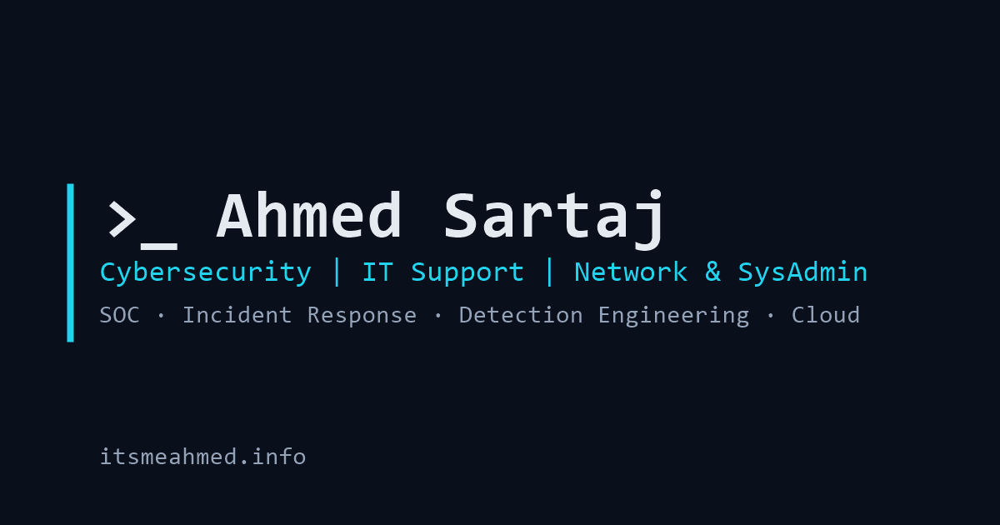

# itsmeahmed.info

Personal portfolio of **Ahmed Sartaj**, a hybrid IT professional working across **Cybersecurity** and **IT Support, Networking & Systems Administration**.

🌐 **Live site:** [https://itsmeahmed.info](https://itsmeahmed.info)



---

## Overview

A fast, accessible, single-page portfolio built with plain HTML, CSS and JavaScript. There is no framework and no build step, and it is hosted for free on **GitHub Pages** with a custom domain registered at **GoDaddy**.

| | |
|---|---|
| **Stack** | HTML5, CSS3 (custom properties, grid), vanilla JS |
| **Fonts** | JetBrains Mono (headings), Inter (body) |
| **Hosting** | GitHub Pages (free HTTPS via Let's Encrypt) |
| **Domain** | `itsmeahmed.info` (GoDaddy) |
| **Contact form** | [Formspree](https://formspree.io) (free tier) |
| **Testimonials** | Owner-managed JSON, loaded at runtime |

### Features

- Dark theme by default with a light-mode toggle (the choice is remembered)
- Mobile-first, responsive layout; keyboard navigable, with a skip link and focus states
- Subtle fade-in animations on scroll that respect `prefers-reduced-motion`
- Experience timeline color-tagged by track: **cyan = Cybersecurity**, **green = IT / Network / SysAdmin**
- Certification badge grid that links to Credly for verification
- "Currently Learning" tracker with animated progress bars
- Testimonials carousel that the owner manages without editing code (no public submission form)
- SEO: meta description, Open Graph and Twitter cards, JSON-LD `Person` schema, `sitemap.xml`, `robots.txt`, favicon, custom 404 page

### Sections

1. Hero (name, tagline, CTAs: *Get in Touch* and *View Resume/CV*)
2. Experience
3. Education
4. Skills
5. Side Projects
6. Awards & Recognition (featuring the **Top Performer Award** with its LinkedIn post)
7. Co-Authored Publication
8. Certifications (Credly)
9. Currently Learning: scripting for cybersecurity; SC-300, IAM and container security; digital forensics
10. Testimonials
11. Get in Touch
12. Footer: LinkedIn, GitHub, X, **Credly**, **Medium**

---

## Project structure

```
.
├── index.html               # All page content (semantic HTML)
├── 404.html                 # Custom not-found page
├── FUTURE_TASKS.md          # Pending to-dos (testimonials, publishing, upkeep)
├── testimonial.html         # Private, unlisted page for mentors to submit testimonials
├── CNAME                    # Custom domain for GitHub Pages
├── .nojekyll                # Serve files as-is (skip Jekyll processing)
├── robots.txt
├── sitemap.xml
├── data/
│   └── testimonials.json    # ← Owner-managed testimonials
└── assets/
    ├── css/style.css        # Theme tokens + all styles
    ├── js/main.js           # Theme toggle, nav, animations, testimonials, contact form
    ├── img/                 # Profile photo, university logo, OG image, favicon
    │   └── badges/          # Certification badge images
    └── resume/              # Ahmed-Sartaj-Resume.pdf (linked from the Hero)
```

---

## Run locally

Testimonials are loaded with `fetch`, so open the site through a local server rather than by double-clicking the file:

```bash
# any one of these
npx serve .
python -m http.server 8000
```

Then visit http://localhost:8000 (or the port shown).

---

## Filling in content

All content comes from Ahmed's CV, certificates and the published paper. Pending work, including enabling testimonials, is tracked in **[FUTURE_TASKS.md](FUTURE_TASKS.md)**.

| What | Where |
|---|---|
| Name, headline, highlight stats | `index.html` → Hero, `<title>`, meta tags, JSON-LD |
| Profile photo | `assets/img/profile.jpg` (square, at least 400×400) |
| Resume | `assets/resume/Ahmed-Sartaj-Resume.pdf`. Replace the file to update it |
| Experience | `index.html` → `#experience`. Add `track-sec` or `track-it` to each `<li>` |
| University logos | `assets/img/algoma-logo.png`, `assets/img/ned-logo.png` |
| Skills | `index.html` → `#skills` pills |
| Projects | `index.html` → `#projects` cards |
| Awards | `index.html` → `#awards`; certificate images in `assets/img/awards/` |
| Publication | `index.html` → `#publication` |
| Certifications | `index.html` → `#certifications`; badge images in `assets/img/badges/` |
| Training & courses | `index.html` → `.course-list` |
| Currently Learning progress | `index.html` → `#learning` (`--p` and `aria-valuenow` on each item) |
| Social links | Footer `.socials` and the JSON-LD `sameAs` list |

Section numbers (01., 02., …) are generated by CSS, so adding, removing or hiding a section renumbers the rest automatically.

**Adding a Credly badge:** open the badge's public page, right-click the badge image and choose *Save image as*, and save it to `assets/img/badges/`. Then copy an existing `.cert` card in `index.html` and change the image, name, issuer and badge URL (`https://www.credly.com/badges/<id>`).

---

## Managing testimonials (owner-only)

Testimonials live in [`data/testimonials.json`](data/testimonials.json) and are fetched by the browser at runtime. The site has **no public submission form**, so only someone with write access to this repository can change them.

> **Status: disabled.** `"enabled": false` at the top of the file hides the entire section. The step-by-step guide to turning it on is in [FUTURE_TASKS.md](FUTURE_TASKS.md#1-turn-on-testimonials).
>
> **Collecting testimonials:** share the unlisted page [`/testimonial.html`](testimonial.html) with mentors. Submissions are emailed to Ahmed through Formspree, with a ready-to-paste JSON entry, and are **never** published automatically.

The section is shown only when `"enabled": true` **and** at least one entry has `"visible": true`. Each entry looks like this:

```json
{
  "quote": "What they said…",
  "name": "Full Name",
  "role": "Title, Organization",
  "relationship": "Professor | Supervisor | Colleague | Manager",
  "photo": "assets/img/testimonials/name.jpg",
  "visible": true
}
```

- **Add:** append a new object to the `testimonials` array.
- **Hide temporarily:** set `"visible": false`.
- **Remove:** delete the object.
- **Photo** is optional. Without one, the person's initials are shown. Only `https://` URLs or paths under `assets/` are accepted.

**Edit from the browser, no code tools needed:** on GitHub, open `data/testimonials.json`, click the ✏️ pencil icon, make your change, and click **Commit changes**. GitHub Pages republishes automatically within about a minute.

**Optional, instant updates without touching the repo:** put the JSON in a secret [GitHub Gist](https://gist.github.com) and change `data-source` on the `#testimonials` section in `index.html` to the Gist's **raw** URL with the commit hash removed:

```
https://gist.githubusercontent.com/<user>/<gist-id>/raw/testimonials.json
```

After that one-time change, editing the Gist updates the site without any commit or deploy.

> All testimonial text is rendered with `textContent`, never as HTML, so content in the JSON can't inject scripts into the page.

---

## Contact form (Formspree)

The form posts to `https://formspree.io/f/xwlvygjr`, which delivers to `itsme_ahmed@outlook.com`. It submits in the background, so visitors stay on the page and see a success or error message. A hidden honeypot field (`_gotcha`) filters out basic bots.

To change the form, edit the `action` attribute on `.contact-form` in `index.html`. In the Formspree dashboard, restrict the form to the domain `itsmeahmed.info` to block spam from other sites.

---

## Deployment: GitHub Pages + GoDaddy domain

### 1. Enable GitHub Pages

1. Open the repository's **Settings → Pages**.
2. Under **Build and deployment**, set **Source** to *Deploy from a branch*, **Branch** to `main`, and the folder to `/ (root)`, then **Save**.
3. Under **Custom domain**, enter `itsmeahmed.info` and **Save**. The `CNAME` file in this repo already contains the domain.
4. Once DNS has propagated (step 2), tick **Enforce HTTPS**.

> On a free GitHub account, Pages requires the repository to be **public**.

### 2. Point the GoDaddy DNS to GitHub

In GoDaddy, go to **My Products → Domains → itsmeahmed.info → DNS → Manage DNS**.

**Turn off the old site first.** The domain currently points to a GoDaddy Website Builder site. Unpublish or disconnect that site (or remove its existing `A`/`CNAME` records for `@` and `www`). Also delete any **Forwarding** rule for the domain.

Then add these records:

| Type  | Name  | Value                       | TTL     |
|-------|-------|-----------------------------|---------|
| A     | `@`   | `185.199.108.153`           | 1 hour  |
| A     | `@`   | `185.199.109.153`           | 1 hour  |
| A     | `@`   | `185.199.110.153`           | 1 hour  |
| A     | `@`   | `185.199.111.153`           | 1 hour  |
| CNAME | `www` | `malcomx21.github.io` | 1 hour |

Optional IPv6 (`AAAA`, Name `@`): `2606:50c0:8000::153`, `2606:50c0:8001::153`, `2606:50c0:8002::153`, `2606:50c0:8003::153`.

**Do not change** the `MX`, `TXT` (SPF/DKIM) or `NS` records if you use email on this domain.

### 3. Verify

```bash
nslookup itsmeahmed.info        # should return the 185.199.10x.153 addresses
nslookup www.itsmeahmed.info    # should resolve via malcomx21.github.io
```

DNS changes usually take effect within an hour but can take up to 48 hours. When the GitHub Pages settings show a green "DNS check successful", enable **Enforce HTTPS**.

**Recommended:** verify the domain under **GitHub → Settings (your profile) → Pages → Add a domain**. Verification adds a `TXT` record in GoDaddy and stops anyone else from claiming `itsmeahmed.info` on GitHub Pages.

---

## Updating the site

Every push to `main` is published automatically:

```bash
git add .
git commit -m "Update experience section"
git push
```

When you make a significant update, change the `<lastmod>` date in `sitemap.xml` too.

---

## License

The code is available under the [MIT License](LICENSE). Personal content (text, photos, resume, logos and badges) is © Ahmed Sartaj, all rights reserved.
